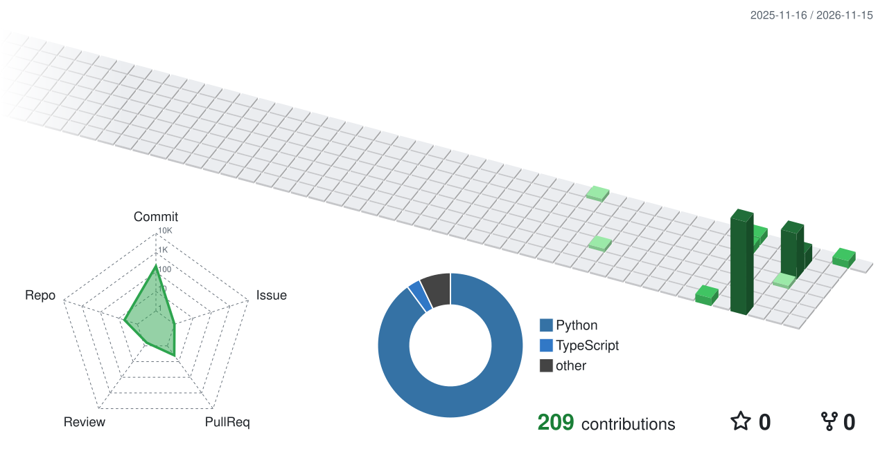

  <picture>
    <source media="(prefers-color-scheme: dark)" srcset="assets/banner-dark.svg">
    
  </picture>

  <h1>Hi, I'm jnvhr <picture></picture></h1>

  

    <picture>
      <source media="(prefers-color-scheme: light) and (min-width: 641px)" srcset="assets/terminal-wide-light.svg">
      <source media="(prefers-color-scheme: light)" srcset="assets/terminal-narrow-light.svg">
      <source media="(max-width: 640px)" srcset="assets/terminal-narrow-dark.svg">
      
    </picture>
  

  

    
    
    
    
    
  

  

    <picture></picture>
    <picture></picture>
    <picture></picture>
    <picture></picture>
    <picture></picture>
    <picture></picture>
     
    Also TypeScript, Swift and Remotion.
  

## Contributions

<picture>
  <source media="(prefers-color-scheme: dark)" srcset="profile-3d-contrib/profile-dark.svg">
  
</picture>

## Everything I've built

| Project | What it is | Where |
| :-- | :-- | :-- |
| **I'm Upping My P(doom)** | A lyric music video rendered frame by frame from Python. 132 versions, 9,402 frames at 60 fps. | [Devlog](https://im-upping-my-pdoom.pages.dev/) · [Source](https://github.com/jnvhr/im-upping-my-pdoom) |
| **Gravity Falls Cipher Tool** | Encodes and decodes the show's cryptograms: Caesar, Atbash, A1Z26, Vigenère, substitution and layered chains. One HTML file. | [Live](https://gravity-falls-cipher-tool.pages.dev/) · [Source](https://github.com/jnvhr/Gravity-Falls-Cipher-Tool) |
| **STRATA** | Scans images, code, pasted text, project folders and video for hidden traces, then strips them. It runs in your browser, so nothing leaves your desk. | [Live](https://strata-stack.pages.dev/) |
| **Moniker** | Turns a long URL into a short one whose tail you choose. No account. The key to a link lives on the device that made it. | [Live](https://mnkr.pages.dev/) |
| **Universal Downloader** | Pulls video and audio from thousands of platforms. Paste a link, get the file. | [Live](https://universal-video-downloader-1-ylon.onrender.com/) |
| **Mesh Workspace** | Local-first, end-to-end encrypted team chat that runs in the browser over private mesh networks. No accounts, no company cloud, no telemetry. | Private, in development |
| **Reclaim** | A Mac cleaner that shows its work. Native Swift app. | Private |
| **Ascend** | A local goal-readiness app. Describe a goal, get a list of requirements, and a rules engine works out what is ready, what is blocked and what to do next. | Private |
| **Map World** | Where to meet, the fastest route and the nearest hospital, for Mega Manila. | Private, planned |
| **Blob Tracking Tool** | Real-time blob and motion tracking for video. Detects moving regions and draws them with styles, filters and connection lines. | Private |

## Open source contributions

| Project | What I did | Status |
| :-- | :-- | :-- |
| [**OpenChatCut**](https://github.com/0xsline/OpenChatCut) Local-first AI video editor | [System font picker and text typography controls](https://github.com/0xsline/OpenChatCut/pull/198) |  |
| | [MCP edit sessions can adopt a draft that is already open](https://github.com/0xsline/OpenChatCut/pull/196) |  |
| [**OpenCLI**](https://github.com/jackwener/OpenCLI) Turns any website into a CLI | [Instagram: read profiles through the web client's own query](https://github.com/jackwener/OpenCLI/pull/2799) |  |
| | [Reddit: read search and subreddits from server-rendered HTML when `.json` is blocked](https://github.com/jackwener/OpenCLI/pull/2798) |  |

[All my public pull requests](https://github.com/search?q=author%3Ajnvhr+is%3Apr+is%3Apublic&type=pullrequests)

The 3D graph is drawn by <a href="https://github.com/yoshi389111/github-profile-3d-contrib">github-profile-3d-contrib</a> and refreshes daily. GIFs are from <a href="https://github.com/Anmol-Baranwal/Cool-GIFs-For-GitHub">Cool-GIFs-For-GitHub</a>.

